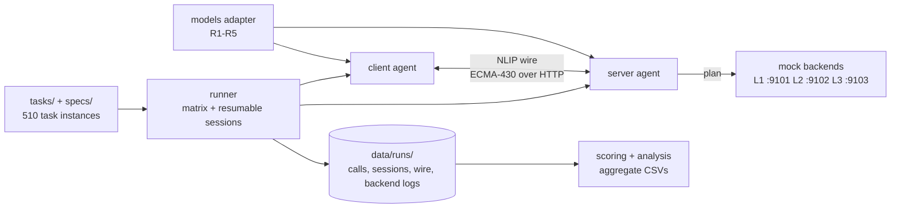

# nlip-bridge-sim

An evaluation of the ECMA Natural Language Interaction Protocol (NLIP, ECMA-430 to ECMA-434). The repository holds the code, configuration, task instances, run registry and aggregate results. Everything lives under [`experiments/`](experiments/).

The question: when an LLM-driven client agent and an LLM-driven server agent talk to each other over NLIP, and their API versions drift apart, does the protocol's interaction step (restate the planned call, ask, correct, confirm) make the call succeed more often, and what does it cost?

> **Status: implementation done (stages 01–07b). Experimentation has not started.** The pilot (stage 08) is next and is waiting on Petr's reviews. No model results exist yet. The only run data is a 12-session smoke run on R3.

## Contents

- [What is evaluated](#what-is-evaluated)
- [Implementation](#implementation)
- [Experimentation](#experimentation)
- [Current progress](#current-progress)
- [Open items](#open-items)
- [Getting started](#getting-started)
- [Repository layout](#repository-layout)
- [Ground rules](#ground-rules)

## What is evaluated

Three real CAMARA telecom APIs are mocked, each at several published versions. A client agent is built against an older version, and a server agent serves the current one.

| Level | API | Versions pinned | Server (current) version |
|---|---|---|---|
| L1 | CAMARA Device Status (reachability) | v0.5.1, v0.6.0, v1.0.0 | v1.0.0 |
| L2 | CAMARA Device Location (verification) | v0.1.0, v0.2.0, v1.0.0, v2.0.0, v3.0.0 | v3.0.0 |
| L3 | CAMARA Quality-on-Demand | v0.8.1, v0.9.0, v0.10.0, v0.11.0, v1.0.0, v1.1.0 | v1.1.0 |

**Conditions**

- **NLIP:** interaction allowed. The server agent restates the planned call and may ask questions. It executes only after the client confirms, with at most 5 interactions.
- **NLIP-0:** no interaction. The server acts on the client's first message and cannot ask.

**Prompts.** P1 is minimal (a role and the agent's own interface). P2 is protocol-aware (P1 plus the NLIP conventions). P3 is interface guidance (P2 plus notes on the agent's own interface).

**Models**

| Rung | Model | Where it runs | Used in main runs |
|---|---|---|---|
| R1 | Qwen3 4B (`nlip-qwen3-4b`, derived from `qwen3:4b`, 65k context) | Ollama on a Mac | yes |
| R2 | `google/gemma-4-12B-it` | RITS | yes |
| R3 | `openai/gpt-oss-20b` | RITS | yes |
| R4 | `deepseek-ai/DeepSeek-V3.2` | RITS | yes |
| R5 | `aws/claude-opus-5-5` | LiteLLM | no, deferred to stage 14 |

Per-rung settings are in [`experiments/config/models.yaml`](experiments/config/models.yaml).

**Per-session outcomes:** request correct, response understood, end-to-end success (both), harmful call (a wrong call that was executed), declined, and cost.

## Implementation

The Python package [`experiments/nlipeval/`](experiments/nlipeval/) (Python 3.12, managed with `uv`) is split by function.



| Package | What it does |
|---|---|
| `models/` | One adapter for all five models: structured output, retries, deadline per call, `reasoning_text` capture, response cache, redacted logging |
| `nlip/` | NLIP message model, validation against ECMA-430, HTTP transport (ECMA-431) |
| `agents/` | Client and server agents, JSON schemas for their turns, prompt rendering |
| `backends/` | Mock CAMARA servers for L1–L3 driven by a fixed "world" (`config/world/`), plus a launcher |
| `tasks/` | Pinned-spec handling, `oasdiff` breaking-change counts, field-level change catalogue, task rendering and gold answers |
| `runner/` | Session state machines for NLIP and NLIP-0, matrix runner with budgets and resume |
| `scoring/` | Scorer (version 1.1.0), comparison of calls against gold |
| `analysis/` | Aggregate tables and quick-look charts |

Other directories:

- [`experiments/stage1/`](experiments/stage1/): the ECMA-430/431 conformance suite (49 checks) and the interoperability matrix. It runs against the `nlip_sdk`, a minimal `nlip_server` app, an echo app, a TypeScript client and our own implementation.
- [`experiments/prompts/`](experiments/prompts/): 8 prompt templates and 14 P3 interface notes, each with a `.sources.md` that gives spec line numbers per statement.
- [`experiments/specs/`](experiments/specs/): 15 pinned OpenAPI files with commit SHAs and checksums (`MANIFEST.yaml`), excerpts for prompts, and the change catalogue.
- [`scripts/start_ollama_r1.sh`](scripts/start_ollama_r1.sh): starts Ollama for R1 with the serving settings from `models.yaml`.

### Session flow

NLIP: the client sends a request. The server answers with an ask, a restate or a decline. The client answers, corrects or confirms. After confirmation the harness executes the plan against the backend, the server reports, and the client returns a final answer. A session takes 5 model calls with no extra interaction, and 5 + 2k calls with k interactions.

NLIP-0: request, server executes or declines, harness executes, server reports, client returns a final answer. 4 calls. If the server tries to ask, the harness logs a protocol slip.

Sessions end as `final`, `declined`, `max_interactions`, `timeout`, `error_model` or `error_harness`. The full state machines are in [`experiments/reports/stage-06-harness.md`](experiments/reports/stage-06-harness.md).

## Experimentation

The evaluation runs in stages. Scope is sections 1–6 of the expected-results mock-up: Stage 1 conformance, Stage 2 basic function, Stage 3 schema progression, and the interaction analysis.

| Experiment | What is varied | Sessions (R1–R4) |
|---|---|---|
| **Stage 1: protocol conformance** | NLIP implementations against ECMA-430/431, no models | n/a |
| **Stage 2: basic function** | Client and server on the same API version. NLIP vs NLIP-0 | 720 |
| **Stage 3: schema progression** | Client 1–5 versions behind. NLIP with P1/P2/P3 and NLIP-0 | 3,960 |
| **Interaction analysis** | Success A(k) by number of interactions, by kind of change, and what interaction prevents and costs | uses the Stage 2 and 3 data |
| **R5 frontier run (stage 14)** | P2 only, NLIP and NLIP-0, on the frozen commit. Runs only if the rule in `FREEZE.md` triggers | 840 |

**Pilot first.** About 420 pilot sessions on separate tasks come before the main runs. Part A is R1–R4 with P2 under NLIP and NLIP-0. Part B is R1 and R3 with P1 and P3 on L3. After the pilot, infrastructure, contract wording, scorer and gold bugs get fixed. Everything that affects results is then frozen under tag `freeze-v1`, and nothing is tuned on main-run results.

**Tasks.** 510 instances: 420 main and 90 pilot. An intent at one client version is one instance. Each carries the client's native request, the facts the client knows, a gold call at the server version, an answer schema, and tags for the kinds of change it exercises (renamed, restructured, removed, changed meaning, and so on). P1 and P3 run only on a fixed half of the intents (the odd-numbered ones). P2 and NLIP-0 run on all of them.

**Data.** Raw run data goes to `experiments/data/runs/<run_id>/` (git-ignored). It has every model call, every NLIP wire message and every backend request, so each number can be recomputed. [`experiments/data/RUNS.md`](experiments/data/RUNS.md) is the committed registry. Aggregate tables are in `experiments/results/`. The data formats are fixed in `bob_plan/data-contract.md`.

## Current progress

Last update in `experiments/STATUS.md`: 2026-11-13. Test suite: **2361 passed, 6 skipped** (`uv run pytest`).

| Stage | Goal | Status |
|---|---|---|
| 01 | Environment, one adapter for five models, smoke tests | closed |
| 02 | 15 pinned specs, breaking-change counts, field-level change catalogue | closed |
| 03 | Stage 1 conformance suite and interoperability matrix | closed |
| 03b | Corrections to 01–03 | done |
| 04 | Mock backends L1–L3, world files, launcher | done |
| 04b | Corrections to 04, R1 serving settings decided | done |
| 05 | 510 task instances with gold answers | done, corrected in 07b |
| 06 | NLIP harness, agents, 8 prompts, 14 P3 notes | done, corrected in 07b |
| 07 | Scorers, metrics, aggregates | done, corrected in 07b |
| 07b | Corrections to 05–07, real smoke run on R3 | done |
| **08** | **Pilot, fixes, freeze** | **next, waiting on Petr's reviews** |
| 09 | Stage 2 runs | not started |
| 10 | Stage 3 runs | not started |
| 11 | Interaction analysis | not started |
| 12 | L4 Kubernetes Gateway controls | deferred |
| 13 | Handoff package for the final analysis | not started |
| 14 | R5 frontier run, conditional | not started |

### Results so far

**Stage 1 conformance.** The headline uses the 32 unflagged checks out of 49. The numbers come from `results/stage1/conformance.csv`, and the full tables are in [`experiments/reports/stage-03-conformance.md`](experiments/reports/stage-03-conformance.md).

| Implementation | Headline (32 unflagged) | All 49 checks |
|---|---|---|
| `nlip_sdk` | 17/23 | 17/27 |
| `nlip_server` (minimal app) | 20/24 | 21/40 |
| `nlip_server` (echo app) | 20/24 | 27/40 |
| TypeScript client | 6/9 | 6/9 |
| Ours | 32/32 | 49/49 |

The interoperability matrix has 20 messages. Ours-to-ours passes 20/20. `nlip_sdk` passes 18/20 against ours and 16/20 against `nlip_server`. Several failures are cases where a client has no way to build the message. Deviations found are written up in `reports/deviations-for-maintainers.md`. **Nothing has been reported upstream.**

**Specs.** The pinned `oasdiff` breaking-change counts per version step are in `results/specs/breaking_changes.csv`. For example, L3 v0.10.0 to v0.11.0 has 10 errors, and L3 v0.11.0 to v1.0.0 has 5 errors and 121 warnings.

**Smoke run (R3, 12 sessions).** The run is `20261113-2205-stage6-smoke-r3`. All 12 sessions finished with `final`. There were 0 errors, 0 parse failures, 0 protocol slips and 0 harmful calls. The wire was valid and the request was correct in 12 of 12. End to end was correct in 6 of 12, and every failure was on the model or answer side. Seconds per session: 23–44. This is a harness check, **not a result**.

**Projected wall time** for stages 08–10, unscaled / scaled for the slower R3 endpoint (`results/prompts/time_projection.csv`):

| Rung | Hours |
|---|---|
| R1 (concurrency 1) | 22.4 |
| R2 | 1.3 / 4.9 |
| R3 | 0.4 / 1.5 |
| R4 | 5.9 / 23.8 |

R5 would cost about $145–177 if stage 14 runs.

## Open items

1. **Petr's reviews before the pilot:** renderer rules (`reports/review-renderer-rules.md`), task sheet (`reports/review-tasks.md`), prompts (`reports/review-prompts.md`) and the 14 P3 notes.
2. **L1 gold precedence.** For L1 v0.5.1 and v0.6.0, devices with both DATA and SMS have gold `CONNECTED_DATA`, from a precedence rule that no text the agents see states. It affects 12 of 30 main instances at each version. Options: keep it, accept either value, or make `unrepresentable` the gold.
3. **R3 endpoint outage.** On 2026-11-13 the R3 endpoint stopped answering. The R3 rows of `results/specs/prompt_excerpt_sizes.csv` have not been re-measured. Re-run `uv run python -m nlipeval.tasks.prompt_sizes R3` once it is back.
4. **Coverage gaps.** L1 `unit_format` has 5 instances (0 in the prompt half). L3 `changed_meaning` has 8 (4 in the prompt half).
5. **R1 speed.** If R1's projected time for stages 09–10 is over 3 days after the pilot, Petr decides whether to switch to a non-thinking Qwen3-4B build.
6. **Matrix check.** `config/runs/stage2-main.yaml` lists only R2–R4 (no R1) and does not restrict P1 and P3 to the prompt half. The plan's Stage 2 volume (720 sessions) covers R1–R4. Check the matrix against the plan before the freeze.
7. **Key rotation (A6)** is not being done, by Petr's decision.

## Getting started

Requires [uv](https://docs.astral.sh/uv/). It fetches Python 3.12.

```bash
cd experiments
uv sync
uv run pytest
```

Credentials go in `experiments/.env`, which is never committed. Copy the variable names from `experiments/.env.example`.

R1 needs Ollama started with the settings in `models.yaml`. Quit the Ollama menu-bar app first, then run `scripts/start_ollama_r1.sh`, or:

```bash
OLLAMA_FLASH_ATTENTION=1 OLLAMA_KV_CACHE_TYPE=q8_0 OLLAMA_NUM_PARALLEL=1 OLLAMA_KEEP_ALIVE=-1 ollama serve
```

Mock backends:

```bash
uv run python -m nlipeval.backends.launcher up --run-dir data/runs/<run_id>
uv run python -m nlipeval.backends.launcher down
```

Run a matrix (resumable; completed sessions are skipped):

```bash
uv run python -m nlipeval.runner.run --matrix config/runs/pilot.yaml
```

More detail is in [`experiments/README.md`](experiments/README.md). Stage-by-stage notes are in [`experiments/STATUS.md`](experiments/STATUS.md) and [`experiments/reports/`](experiments/reports/).

## Repository layout

```
experiments/
  config/       models.yaml, run matrices (pilot, smoke, stage 2), world files, answer schemas
  nlipeval/     Python package (models, nlip, agents, backends, tasks, runner, scoring, analysis)
  prompts/      client/server templates (P1–P3, NLIP-0), P3 notes
  specs/        pinned OpenAPI files, excerpts, change catalogue
  stage1/       ECMA-430/431 conformance suite and interop harness
  tasks/        510 task instances (JSON) and INDEX.csv
  data/         RUNS.md (committed); runs/ is git-ignored
  results/      aggregate CSV tables
  reports/      one report per stage, review sheets
  tests/        pytest suite
scripts/        start_ollama_r1.sh
```

`bob_plan/` (the stage plans), `docs/` (evaluation plan and mock-up of expected results) and `paper-draft/` are listed in `.gitignore` and are not in the repository. They are kept locally. The plan overview is `bob_plan/00-overview.md`.

## Ground rules

- Never invent, edit or "fix" run data. A wrong run is re-run under a new run ID, and the reason is recorded in `RUNS.md`.
- Nothing is tuned on main-run results. Prompts, tasks, gold answers, scorers and settings change only before the freeze.
- Every call, wire message and backend request is logged.
- Secrets come from `experiments/.env`, and `Authorization` headers are redacted in logs.
- Identifiers are synthetic: a fictional phone range, IPv4 from the documentation ranges, IPv6 from `2001:db8::/32`.
- Do not push, open pull requests or file upstream issues without Petr's approval.

## Licence

See [`LICENSE`](LICENSE).
